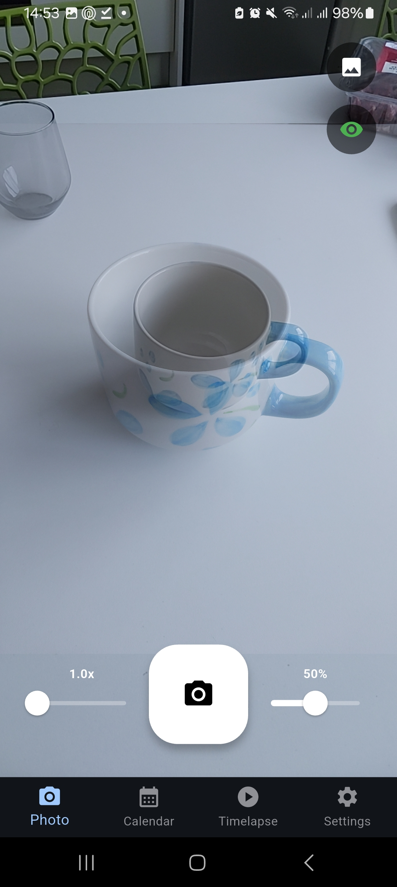
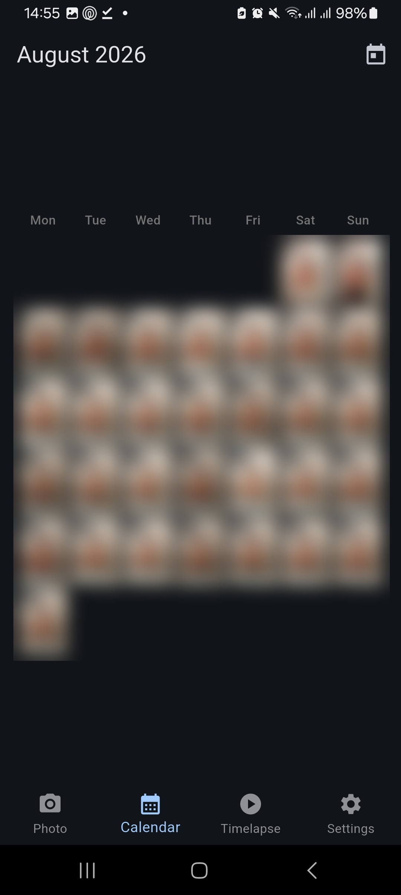
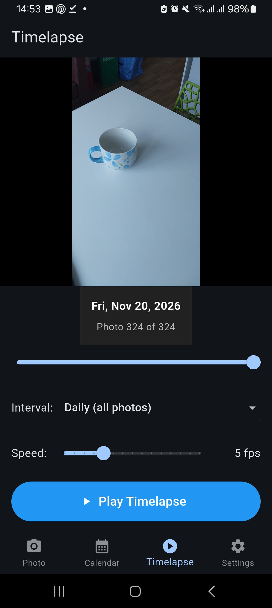
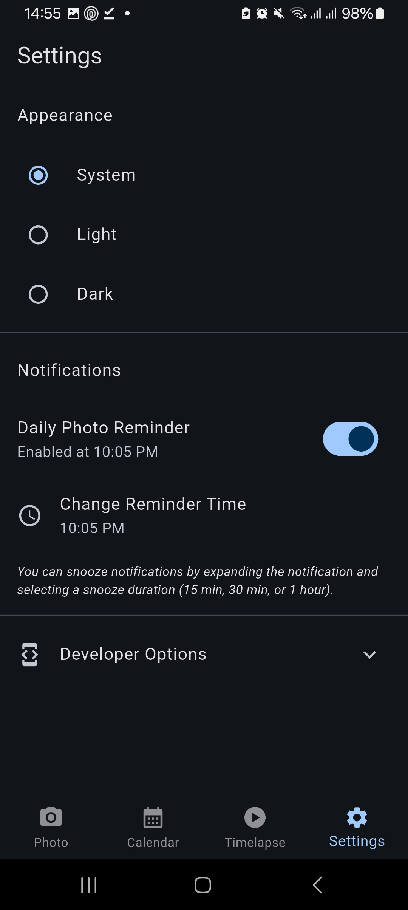

# DayOne

A mobile app for tracking physical progress with one photo a day. You line up each day's photo against a reference image, then play the photos back as a timelapse.

Built with Flutter (Dart), with native Android code (Kotlin) for notifications.

<p>
  
  
  
  
</p>

## The problem

Day-to-day changes are too small to notice, and progress photos taken at different distances, angles and zoom levels are hard to compare. DayOne keeps every photo framed the same way, so the timelapse shows real change rather than differences in framing.

## Features

- **Camera with ghost overlay**: choose a reference photo and it is shown semi-transparently over the live camera view (adjustable opacity), so you can match your pose and position. Pinch-to-zoom, and the zoom level is remembered between sessions.
- **Manual alignment**: drag, pinch and rotate a photo to line it up with the reference. Aligned photos are cropped to a consistent 9:16 portrait frame, and the original is kept as a backup so alignment can be re-edited later.
- **Calendar view**: a month-by-month calendar showing which days have a photo. Tap a day to view it or to add a missed photo from the camera or gallery.
- **Photo viewer**: browse photos by date, compare against the overlay, re-align or delete.
- **Timelapse**: plays the photos back in order, with a scrubber, adjustable speed (1-15 fps) and daily, weekly, monthly or yearly intervals.
- **Daily reminders**: a notification at a time you choose, with snooze actions (15 min, 30 min, 1 hour) directly on the notification. Reminders are rescheduled after the phone restarts.
- **Light / dark / system theme.**
- **Private by design**: photos are stored only on the device. The app makes no network requests and has no account or backend.

## How it works

| Area | Implementation |
|---|---|
| State | `provider` (`ChangeNotifier`) with settings persisted in `shared_preferences` |
| Camera | `camera` plugin, reference overlay stacked over the preview |
| Alignment | `GestureDetector` scale/rotate/translate applied with a `Transform`, then rendered off-screen at 4x pixel ratio and cropped/encoded with the `image` package |
| Storage | One JPEG per date (`YYYYMMDD.jpg`) in the app documents directory, plus `_orig` backups |
| Timelapse | Filters photo dates by interval, pre-caches images and steps through them on a timer |
| Notifications | `flutter_local_notifications` + `timezone` for scheduling; Kotlin `BroadcastReceiver`s handle snooze actions and re-scheduling after boot |

## Project structure

```
lib/
  main.dart                  App entry, bottom navigation
  app_state.dart             Global state and persisted settings
  camera_page.dart           Camera with reference overlay and zoom
  photo_review_page.dart     Review a new photo before saving
  photo_alignment_page.dart  Drag/pinch/rotate alignment and export
  photo_viewer_page.dart     Browse, re-align and delete photos
  calendar_page.dart         Monthly calendar of photo days
  timelapse_screen.dart      Timelapse playback and controls
  settings_page.dart         Theme and reminder settings
  notification_service.dart  Daily reminder and snooze scheduling
  photo_storage.dart         Saving and loading photos by date
android/app/src/main/kotlin/ Boot and snooze receivers
```

## Running it

Requires the [Flutter SDK](https://docs.flutter.dev/get-started/install) (Dart 3.10+).

```bash
flutter pub get
flutter run
```

The app was developed and tested on Android.

## Possible next steps

- Automatic alignment using pose or landmark detection instead of manual adjustment
- Exporting the timelapse as a video
- Side-by-side comparison of any two dates
